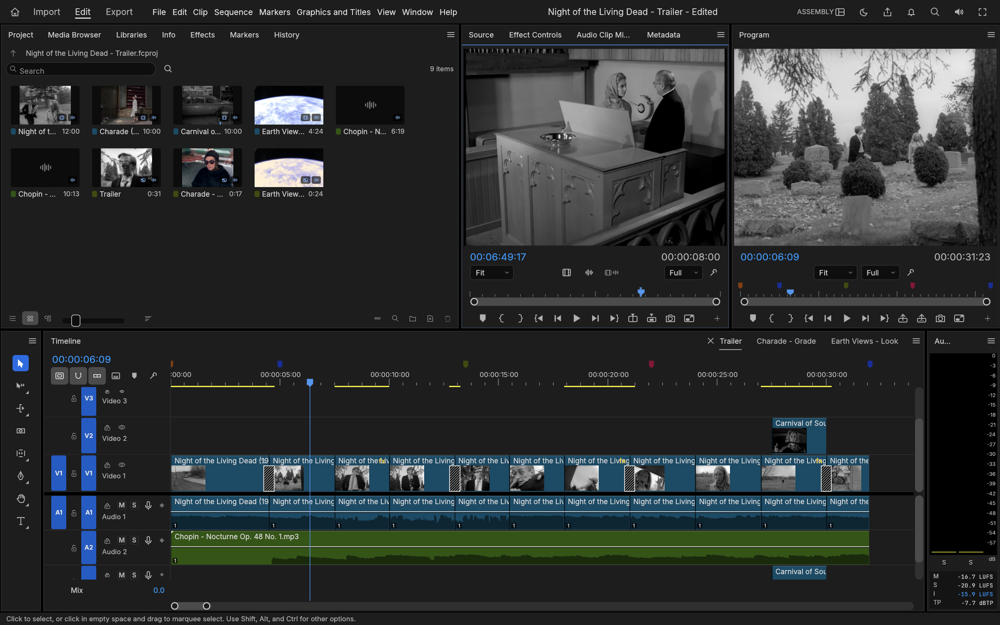
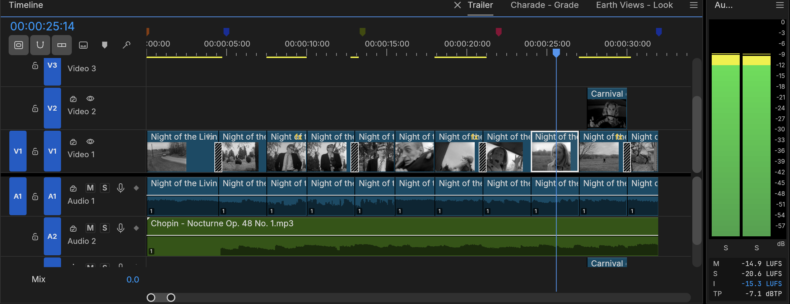
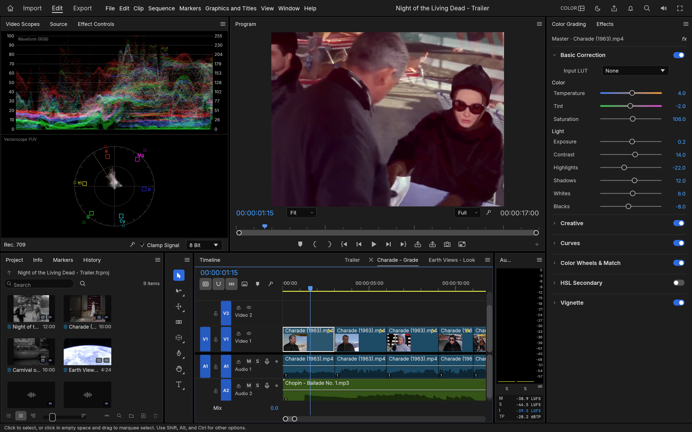
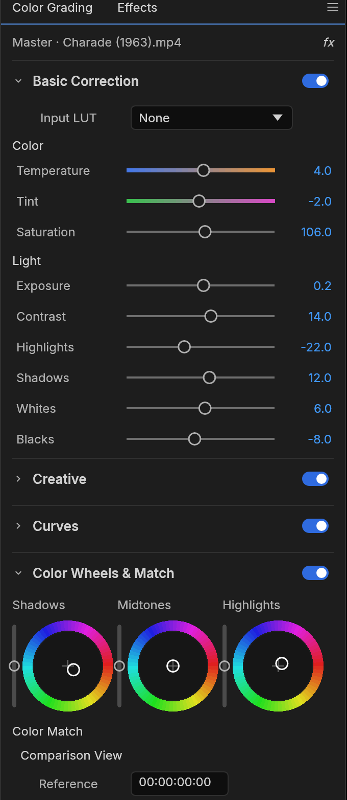
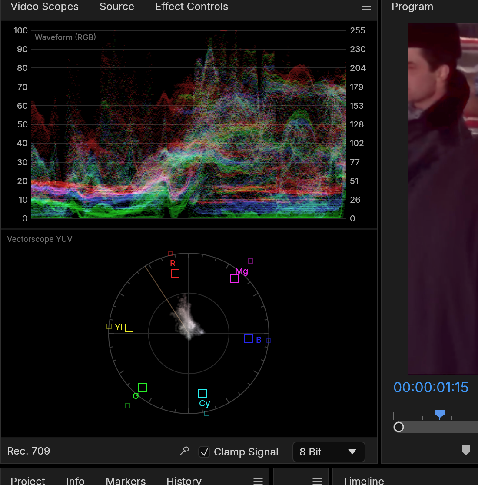
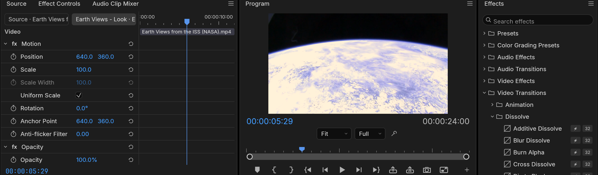
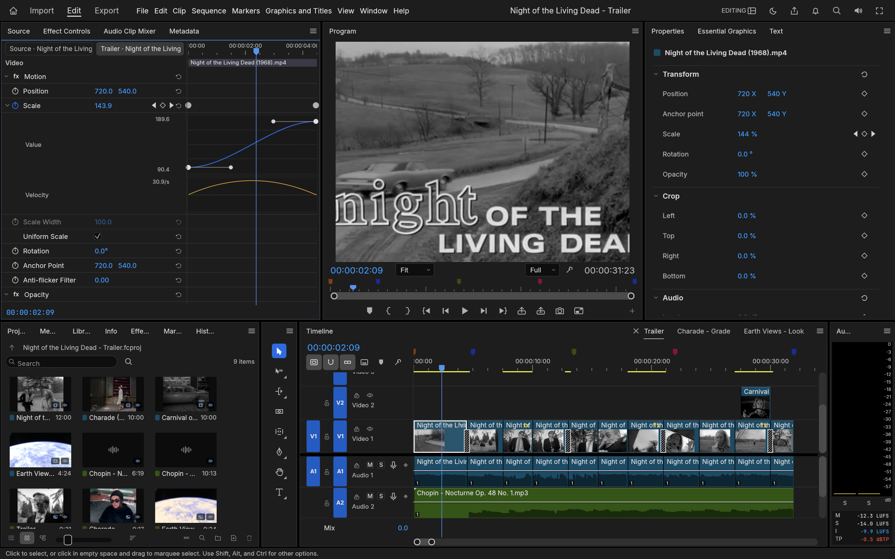
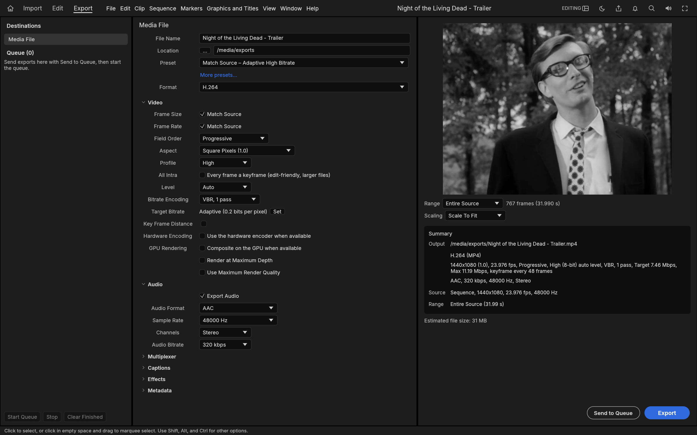

<h1 align="center">Filmagic</h1>

<p align="center">
  <b>Video editing by prompt. An open-source, professional non-linear video editor, built in pure Rust, that an AI agent can drive as precisely as you can.</b>
</p>

<p align="center">
  Editing, color and sound: native on macOS, Windows and Linux, and in the browser via WebAssembly.
</p>

<p align="center">
  <a href="#license-and-credits"></a>
  
  
  <a href="#status"></a>
</p>

<br>

<p align="center">
  
</p>

<p align="center"><sub><i>Apollo 11 - Tranquility</i>: a three-minute documentary edit of NASA's 1969 launch, landing and moonwalk film, with subtitles from the mission transcript. Every frame in these screenshots comes from public-domain footage, decoded, composited and graded by the app's own code.</sub></p>

<p align="center">
  <a href="#edit-by-prompt">Edit by prompt</a> ·
  <a href="#edit">Edit</a> ·
  <a href="#color">Color</a> ·
  <a href="#effects-and-motion">Effects</a> ·
  <a href="#audio">Audio</a> ·
  <a href="#titles-and-captions">Titles</a> ·
  <a href="#formats-and-codecs">Formats</a> ·
  <a href="#export">Export</a> ·
  <a href="#interchange">Interchange</a> ·
  <a href="#built-for-agents">Agents</a> ·
  <a href="#get-started">Get started</a> ·
  <a href="#documentation">Docs</a> ·
  <a href="#status">Status</a>
</p>

<br>

Filmagic is a professional non-linear editor: familiar panels, workspaces, tools and shortcuts, so your hands already know where everything is. Underneath, it is written from the bitstream up. The H.264, HEVC, ProRes and AAC codecs are Rust code written from the public specifications. A GPU compositor works in linear light. Frame math runs on exact integer time, so edits never drift. And every action in the app is a command, so you can say what you want and let an agent make the edit.

<br>

## Edit by prompt

Filmagic runs an **MCP server**. Connect Claude or any other agent and describe the edit; the agent makes it with the same commands the interface uses, looks at the result, and tells you what it changed. On top of the editor's ordinary commands there are two families made for this way of working ([docs/story-and-layers.md](docs/story-and-layers.md)):

- **Layers inside a shot.** `layers.extract`, `layers.lift`, `layers.cleanPlate`, `layers.retime` and `layers.adjust` treat a region of a clip as a layer of its own: bring a figure closer or push it away, take a passer-by out of a locked-off shot, slow one half of the frame and leave the other at speed, lift a face out of the shade and touch nothing else. A region can be read straight off the rendered frame, and masks can follow their subject.
- **Relight.** `color.relight` grades a shot toward the light of an hour of the day, or carries it from noon into the night across the clip.
- **Story tools.** The ideas of Walter Murch's *In the Blink of an Eye*, measured: `story.rhythm` reads the cutting pace against blink rates, `story.cuts` weighs each cut on what can be measured of the six criteria (and leaves emotion and story, which outweigh the rest, to the editor), `story.blinkPoints` finds where a phrase or a movement completes, `story.splitEdit` makes an L or J cut, `story.board` shows the film as one frame per shot, and `story.shadowCut` with `story.compare` keep versions and say shot by shot what differs.
- **Scene detection that finds the quiet cuts.** `clip.sceneEditDetection` also cuts between two shots that look alike, and does not take a camera flash for a cut.

Every command that changes the picture reports how much a viewer will see of it (`none`, `subtle`, `visible`, `strong`), and says in `warnings` what it could not do.

```jsonc
// MCP tool calls: "bring the man on the right closer", "make it dusk", "is this cut any good?"
{"id": "layers.extract",  "params": {"clip": 12, "region": {"space": "frame", "x": 0.60, "y": 0.34, "w": 0.08, "h": 0.36}}}
{"id": "color.relight",   "params": {"clip": 12, "time": "12:00", "toTime": "20:30"}}
{"id": "story.cuts",      "params": {"seconds": 19.0}}
```

**No pixel is generated.** These commands move, mask, re-time and grade the frames a camera recorded. Replacing an object with another, or showing a place in another decade, takes a generative video model; Filmagic has none and does not pretend to.

<br>

## Edit

<p align="center">
  
</p>

<p align="center"><sub>The Assembly workspace, cutting a trailer for <i>Night of the Living Dead</i> (1968) with an insert from <i>Carnival of Souls</i> (1962).</sub></p>

**A timeline you already know.** Source and Program monitors, bins with thumbnails, a multi-track timeline with patch and target buttons, sync locks and linked selection. The Editing, Assembly, Color, Effects and Audio workspaces are all there, and every panel docks wherever you want it.

- **Three-point editing.** Mark In and Out in the Source monitor, then insert (`,`) or overwrite (`.`) onto the patched tracks. Lift (`;`) and extract (`'`) take ranges back out.
- **Every trim.** Ripple, roll, slip, slide, rate stretch and razor tools. Trim mode selects edit points as ripple, roll or trim, nudges them a frame at a time (`⌥←` `⌥→`, ×5 with `⇧`), toggles the trim type with `⌃T` and extends them to the playhead with `E`. `Q` and `W` ripple-trim to the playhead. The **Trim Monitor** shows both sides of the edit, and **dynamic trimming** trims live while it plays: `L` forward, `J` back, `K` to stop and commit as one undo step.
- **Exact time.** Every edit is computed on integer ticks: 254,016,000,000 per second, which divides evenly by every common frame rate and sample rate. 23.976, 29.97 drop-frame and 59.94 are exact, not approximate.
- **The details pros rely on.** Markers with colours, names and durations; export sequence review notes with **Markers ▸ Export Markers as CSV…**; add edit (`⌘K`) on one or all tracks; nesting; copy, paste and paste insert; ripple delete and close gap; snapping; unlimited undo with a History panel.
- **Your keys.** A Keyboard Shortcuts editor (`⌥⌘K`) with a drawn keyboard, panel-specific shortcuts, conflict warnings and presets for its own and standard NLE key layouts.
- **Never lose work.** Saves are atomic, auto-save keeps a rolling set of versions, and a crash-recovery journal written about a second after each edit brings back unsaved changes after a crash or power cut.

<p align="center">
  
</p>

<p align="center"><sub>Up close: dissolves, an insert on V2, the score on A2, coloured markers, and the loudness meters on the right.</sub></p>

<br>

## Color

<p align="center">
  
</p>

<p align="center"><sub>The Color workspace on <i>Charade</i> (1963), with live scopes beside the Program monitor.</sub></p>

**A complete color grading panel**, in the order a colourist works:

- **Basic Correction:** temperature and tint, exposure, contrast, highlights, shadows, whites, blacks, saturation.
- **Creative:** eight built-in looks with an intensity control, plus faded film, sharpen and vibrance. The looks are colour transforms written in code, not LUT files.
- **Curves:** an RGB curve editor with monotone-cubic interpolation (no overshoot), and hue vs saturation, hue vs hue, hue vs luma, luma vs saturation and saturation vs saturation.
- **Color Wheels:** shadow, midtone and highlight wheels, each with its own lightness control.
- **HSL Secondary:** key a colour by hue, saturation and luma, view the key as a matte, and correct only what you selected.
- **Vignette:** amount, midpoint, roundness and feather.

<table>
  <tr>
    <td width="34%" valign="top" align="center">
      <br>
      <sub><b>The color grading panel.</b> Basic Correction, Color Wheels and every other section, each with its own on/off switch.</sub>
    </td>
    <td width="66%" valign="top" align="center">
      <br>
      <sub><b>Scopes that tell the truth.</b> The waveform and vectorscope are computed from the graded frame. All grading happens in linear light, in 32-bit float.</sub>
    </td>
  </tr>
</table>

<br>

## Effects and motion

<p align="center">
  
</p>

<p align="center"><sub>NASA's <i>Earth Views from the ISS</i> with a look applied, and the Effects browser open on the dissolves.</sub></p>

- **A comprehensive Video Effects bin (over 90 effects across 16 categories), legacy effects, plus around 30 transitions.** Blurs (Bokeh, Focus, Compound), keys (Ultra Key, Track Matte), distortions (Corner Pin, Turbulent Displace, Warp Stabilizer), Lights & Glows, Immersive Video (VR) effects on equirectangular footage, Posterize Time, Echo and more. Cross dissolve, dip to black or white, film dissolve, wipes, irises, pushes, slides, zooms, page peel, cube spin and more.
- **Motion and opacity on every clip:** position, scale, rotation, anchor point and anti-flicker, plus 26 blend modes.
- **Advanced keyframing:** linear, Bezier, auto and continuous Bezier, hold, ease in and ease out. Effect Controls shows a keyframe lane for every parameter under a time ruler with the playhead's handle, and each animated parameter opens into **value and velocity graphs** with draggable influence handles. Effect Controls and the Properties panel share the keyframe navigator (◀ ◆ ▶): add or remove the keyframe at the playhead, step to the previous or next one.
- **A GPU compositor** built on wgpu (Metal, Vulkan, DirectX 12, WebGPU). It samples YUV straight from the decoder with footprint supersampling and blends in linear light. A CPU path renders the same frames, and the two are tested against each other.

<p align="center">
  
</p>

<p align="center"><sub>An eased push-in on the title card: the value graph, the velocity graph and the Bezier influence handle.</sub></p>

<br>

## Audio

- **Loudness meters to broadcast standards.** Momentary, short-term and integrated loudness and true peak to ITU-R BS.1770 and EBU R128, alongside the peak meters. The integrated reading matches ffmpeg's `ebur128` filter to the tenth of a LU.
- **Clip effects on its own DSP library:** parametric EQ, high-pass, low-pass and band-pass filters, dynamics, a true-peak limiter, delay, reverb, DeNoise, DeHummer, invert and pitch shift. Parameters can be keyframed. Effects stay continuous across scrubbing, playback and export, with latency compensated.
- **Audio Track Mixer and Audio Clip Mixer:** faders, pan, mute, solo, five insert slots per track (pre- or post-fader), sends, submixes and a Mix track, all sample-accurate and latency-compensated. 24 tracks with three effects each mix about six times faster than real time on one core.
- **Automation like a console:** Read, Latch, Touch and Write modes recorded live from the mixer during playback, shown and edited as track keyframes on the timeline. Plus the Audio Gain dialog (set, adjust, normalize) and constant-power crossfades.
- **Audio-clock playback.** The sound card is the master clock, so picture follows sound and never the other way round.

- **Narration from a script:** Text to Speech with built-in voices, natural English voices (Kokoro-82M, downloaded one voice at a time), and **Vietnamese voices from [VieNeu-TTS](https://github.com/pnnbao97/VieNeu-TTS)**, an optional offline engine. Transcription (Whisper) takes any of its languages, Vietnamese included.

<br>

## Narration and transcription in Vietnamese

Vietnamese narration uses VieNeu-TTS (Apache-2.0, offline, runs on the CPU). It is not bundled: Filmagic runs it through a Python that has the `vieneu` package installed, the way it would run ffmpeg. Everything else in Filmagic works without it.

On Windows 10 or 11:

1. Install Python 3.10 or newer from [python.org](https://www.python.org/downloads/windows/). Tick **Add python.exe to PATH**, then open a new terminal.
2. Let Filmagic set it up. Ask your agent to run `tts.setupVieneu {"install": true}`, or run `filmagic-cli exec tts.setupVieneu install=true wait=true`. This creates a Python environment in the models folder, installs `vieneu` (about 0.9 GB), downloads the voice model (about 0.6 GB) and lists the voices. To do it by hand, `tts.engines` prints the exact commands, for example:
   ```bat
   py -3 -m venv "%APPDATA%\Filmagic\models\vieneu\venv"
   "%APPDATA%\Filmagic\models\vieneu\venv\Scripts\python.exe" -m pip install vieneu
   ```
3. `tts.voices` now lists voices such as `vieneu:Hải Đăng` and `vieneu:Mai Anh`. Use them with `tts.create`, or pick **Vietnamese** in the Text to Speech panel.

If your Python is somewhere else, set **Settings ▸ Media Analysis & Transcription ▸ Python for VieNeu-TTS** (`mediaAnalysis.vieneuPython`) or `FILMAGIC_VIENEU_PYTHON`.

For Vietnamese transcription and captions, download the speech model `whisper-large-v3-turbo` (1.6 GB) and transcribe with `language: "vi"`.

**Short on disk space?** All models (speech models, voices, VieNeu) live in one folder. Choose it in **Settings ▸ Media Analysis & Transcription ▸ Models location**, or set `FILMAGIC_MODELS_DIR`. `models.setLocation {"dir": "D:\\FilmagicModels"}` moves what is already installed. Details are in [docs/agents.md](docs/agents.md#vietnamese-narration-transcription-languages-and-the-models-directory).

<br>

## Titles and captions

- **A real text engine:** OpenType shaping with kerning and ligatures, bidirectional text, line breaking, tracking and leading, drawn in linear light and sharp at any scale or rotation.
- **Type, Shape and Pen tools** on the Program monitor: click to type, edit with a caret and selection, drag out rectangles, ellipses and paths. Graphic clips hold text and shape layers with fill, strokes, background and shadow, all keyframable, and edited in the Properties panel.
- **Captions:** caption tracks in Subtitle, CEA-608, CEA-708 and Teletext formats; import and export SRT, WebVTT and SCC with frame-exact timing; edit captions in the Text panel and burn them into exports.

<br>

## Formats and codecs

No FFmpeg inside. The video codecs, AAC, Opus and the containers are Rust code in this repository, implemented from the public ITU-T, ISO and IETF specifications and tested frame by frame against ffmpeg as an external oracle.

| | Decode | Encode | Notes |
|---|:---:|:---:|---|
| **H.264 / AVC** | ✓ | ✓ | Decoder bit-exact on 37+ streams, 500–600 fps at 1080p. Encoder: High, Main and Baseline profiles, CABAC, B-frames, CRF/CBR/VBR/2-pass |
| **HEVC / H.265** | ✓ | | Main and Main 10, bit-exact on 41 streams (tiles, WPP, PCM, long-term references), about 225 fps at 1080p |
| **Apple ProRes** | ✓ | ✓ | Decodes 422 Proxy to 4444 XQ; export writes 422 HQ |
| **AAC-LC** | ✓ | ✓ | |
| **VP8** | ✓ | | Every coding tool, bitstream versions 0–3, hidden altref frames, alpha layer of transparent WebM; bit-exact with libvpx on its published VP8 test vectors; in WebM/Matroska and MP4 |
| **VP9** | ✓ | | Profiles 0–3, 8/10/12-bit, 4:2:0 to 4:4:4, tiles and superframes; bit-exact on 50+ streams; in WebM/Matroska and MP4 |
| **Opus** | ✓ | | SILK, CELT, hybrid and multistream surround; range-exact on every RFC 8251 conformance vector; in WebM/Matroska and MP4 |
| **AV1** | ✓ | | Main profile, 8/10-bit 4:2:0 and monochrome, every coding tool incl. film grain, superres and spatial layers; bit-exact with libdav1d on the libaom vectors tested; in MP4 and WebM/Matroska |
| **DNxHD / DNxHR** | ✓ | ✓ | All SMPTE ST 2019-1 CIDs (LB to 444, 8/10/12-bit); export writes DNxHR in MOV |
| **MJPEG, PCM** | ✓ | ✓ | |
| **MP3, FLAC, ALAC, Vorbis** | ✓ | | Via the [symphonia](https://github.com/pdeljanov/Symphonia) crate (MPL-2.0) |
| **MP4 / MOV** | ✓ | ✓ | Fragmented MP4, edit lists, timecode tracks |
| **Matroska / WebM** | ✓ | | Lacing, Cues, header stripping, HDR colour metadata |
| **AVI** | ✓ | | AVI 1.0 and OpenDML (files past 1 GB); Motion JPEG, H.264, HEVC and uncompressed RGB / YUV with PCM, MP3, MP2 or AC-3. DivX / Xvid and DV not yet |
| **Stills** | ✓ | ✓ | Import PNG, JPEG, GIF, WebP, TIFF and BMP (animated GIF, APNG and WebP as clips, with transparency); export PNG sequences and animated GIF |

Also imported: MPEG-2 / MPEG-1 video, AC-3, MP2, MXF (OP1a / OP-Atom), MPEG transport and program streams (AVCHD, broadcast, DVD), Ogg and image sequences. Not yet: AV1 export, camera RAW, E-AC-3. Hardware decoding works on macOS (VideoToolbox), Windows (Media Foundation) and, for H.264 and HEVC, Linux (VA-API); H.264 export can use NVIDIA's encoder on Windows and Linux (opt-in), and H.265 (HEVC Main, 8-bit) export works through a hardware encoder (NVENC on Windows, VideoToolbox on macOS).

<br>

## Export

<p align="center">
  
</p>

<p align="center"><sub>Export mode, set to write the trailer as H.264 MP4.</sub></p>

- **H.264 MP4 with AAC, using its own encoders.** A 6-second 960×540 render takes 1.3 seconds and decodes in ffmpeg without a single warning, with strict error detection on.
- **Also:** Apple ProRes 422 HQ and Motion JPEG in QuickTime, MXF OP1a and standard OP-Atom (DNxHR, ProRes or H.264 with PCM and start timecode), PNG sequences, animated GIF and WAV.
- **Background jobs** with progress and cancel, so you keep editing while it renders.
- **Render previews:** the render bar marks segments green, yellow or red; rendered previews are cached by content, so an edit only invalidates what it touches and undo brings the green back.

<br>

## Interchange

Move timelines between Filmagic and every other editor:

- **FCP 7 XML (xmeml):** industry-standard timeline interchange format. It carries nested sequences, transitions, generators, Motion, Opacity, Time Remap and audio levels, with keyframes.
- **FCPXML 1.9–1.11:** the spine, connected clips as lanes, transitions, retiming and compound clips.
- **OpenTimelineIO:** the open interchange format of the film industry, round-tripping every detail of a project through its own metadata namespace.
- **CMX 3600 EDL:** the oldest format still in use, with drop-frame timecode, dissolves, wipes, speed changes (`M2`) and one EDL per track.
- **AAF (Edit Protocol):** standard timeline and audio interchange format. Video and audio tracks, dissolves and dips, clip volume with keyframes, markers and source timecode; audio embedded or as separate WAV / AIFF files, trimmed with handles, with clip effects rendered in and broken out to mono, plus an optional video mixdown. Import reads AAF back, extracting embedded audio.
- **OMF 2.0:** the audio-post handoff: the audio tracks with crossfades and gain, sample-accurate, with the audio encapsulated or alongside.

Import merges the document's bins, media and sequences into your project as one undoable step, and links each media file it finds on disk.

<br>

## Built for agents

Every menu item, button, slider and drag in Filmagic is a **command** with an id, typed parameters and an enabled state. There are more than 650 engine commands (the command-line tool's `commands` lists them). The UI, the CLI, a JSON control channel and the **MCP server** all dispatch the same commands, so Claude or any agent can cut, trim, grade, mix and export exactly the way a person does. The UI can also be driven at the level of mouse and keyboard: every widget has an automation id, and agents can click, drag, type and take screenshots.

```jsonc
// over the control channel (JSON lines on TCP) or as MCP tool calls
{"method": "engine.execute", "params": {"command": "timeline.place",
  "params": {"item": 1, "track": "V1", "seconds": 0, "sourceIn": 284298240000000, "duration": 1270080000000}}}
{"method": "engine.execute", "params": {"command": "effects.setParam",
  "params": {"clip": 87, "effect": "lumetri", "param": "curve_luma", "value": [[0,0],[0.25,0.21],[0.75,0.82],[1,1]]}}}
{"method": "ui.screenshot", "params": {"path": "frame.png"}}
```

The trailer and the grades in these screenshots were built exactly this way, by an agent driving the running app.

<br>

## Everywhere

- **Native** on macOS, Windows and Linux, with a native macOS menu bar.
- **The web:** the same engine and UI run in the browser via WebAssembly (see [docs/web.md](docs/web.md)).
- **Swappable UI.** The interface is one crate (`ui-egui`) over the engine, so a different front end can replace it without touching editing logic.

<br>

## Get started

Filmagic is built from source with a stable Rust toolchain (1.95 or newer); no releases are published yet. On Linux, first install a C toolchain and the ALSA development package (Debian and Ubuntu: `sudo apt install build-essential pkg-config libasound2-dev`; others in [docs/contributing.md](docs/contributing.md#1-setup)).

```sh
git clone https://github.com/vansyson1308/editfilm && cd editfilm
cargo build --release -p filmagic -p filmagic-cli    # the desktop app and the command-line tool
./target/release/filmagic                            # open the desktop app on a demo project
```

### Connect an agent

The agent starts the MCP server itself, over stdio, when it launches: you do not run `filmagic-cli mcp` in a terminal. There are two servers. **Headless** (`filmagic-cli mcp --demo`, or `--project <file.fcproj>`) edits a project in the background, with no window. **Bridge** (`filmagic-cli mcp --bridge 127.0.0.1:9876`) drives the desktop app you have open.

**Claude Code, inside this repository.** The checkout's [`.mcp.json`](.mcp.json) registers both servers (`filmagic-headless` and `filmagic`, the bridge). Start Claude Code in the checkout and approve them when asked:

```sh
claude                    # in the editfilm folder; /mcp lists the servers
```

**Claude Code, from any folder.** Register the binary you built by its absolute path (`--scope user` makes it available in every project; it goes before `--`, which hands everything after it to `filmagic-cli`):

```sh
claude mcp add --scope user filmagic-headless -- /path/to/editfilm/target/release/filmagic-cli mcp --demo
```

**Codex.** Codex reads [`AGENTS.md`](AGENTS.md) on its own but not `.mcp.json`. `codex mcp add` always writes your global `~/.codex/config.toml`, so one command covers the checkout and every other folder:

```sh
codex mcp add filmagic-headless -- /path/to/editfilm/target/release/filmagic-cli mcp --demo
codex                     # /mcp lists the servers
```

Use `mcp --project /path/to/film.fcproj` instead of `--demo` to edit your own project.

**Drive the desktop app.** The app's control server stays closed until it has a token: 64 random hex characters, shared by the app and the bridge through `FILMAGIC_CONTROL_TOKEN`. The agent starts the bridge when it launches, with the environment it had then, so export the token first and start the app and the agent from that same shell. An agent that is already running cannot pick the token up, not even by exporting it in its own shell tool or reconnecting from `/mcp`: quit it and start it again from the shell that exported the token.

```sh
export FILMAGIC_CONTROL_TOKEN="$(openssl rand -hex 32)"      # or: python3 -c 'import secrets; print(secrets.token_hex(32))'
./target/release/filmagic --control 9876 >/dev/null 2>&1 &   # its log is still written to Logs/filmagic.log
claude                    # inside the checkout: the `filmagic` server in .mcp.json is the bridge
```

On Windows (PowerShell):

```powershell
$b = [byte[]]::new(32); [Security.Cryptography.RandomNumberGenerator]::Create().GetBytes($b)
$env:FILMAGIC_CONTROL_TOKEN = -join ($b | ForEach-Object { $_.ToString('x2') })
Start-Process .\target\release\filmagic.exe -ArgumentList '--control','9876'
claude
```

From another folder, add the bridge with `claude mcp add --scope user filmagic -- /path/to/editfilm/target/release/filmagic-cli mcp --bridge 127.0.0.1:9876`. Codex has no `codex mcp add` form for the bridge (`--env` would store the token's value): add it to `~/.codex/config.toml` by hand with `env_vars = ["FILMAGIC_CONTROL_TOKEN"]`, as [docs/agents.md](docs/agents.md#codex) shows. An agent can also drive the app without MCP, through the command-line tool: `./target/release/filmagic-cli --bridge 127.0.0.1:9876 exec sequence.clips` reads the token from its environment, and an agent whose own environment lacks it can put it in front of that one command (`FILMAGIC_CONTROL_TOKEN=<token> ./target/release/filmagic-cli --bridge …`).

The command-line tool works without an agent too: `./target/release/filmagic-cli commands` lists every engine command, and `./target/release/filmagic-cli --help` shows the rest.

New to editing here? Follow [Getting started: video fades and audio volume keyframes](docs/getting-started-fades.md). The control protocol is documented in [docs/control-protocol.md](docs/control-protocol.md), and the loop an agent works in is in [docs/agents.md](docs/agents.md).

Japanese and other non-Latin text in the interface and in titles comes from an optional build input, a checkout of the fonts repository named in [AGENTS.md](AGENTS.md), passed as `CRAFT_FONTS_DIR=<absolute path>`. Without it the app uses its bundled and the system's fonts.

## Documentation

| | |
|---|---|
| [docs/story-and-layers.md](docs/story-and-layers.md) | Editing by prompt: the commands that measure an edit (rhythm, cuts, blink points, the board) and work on part of a picture (layers, clean plates, relight) |
| [docs/agents.md](docs/agents.md) | Driving the editor over MCP and the control channel |
| [docs/control-protocol.md](docs/control-protocol.md) | Control-channel and MCP reference |
| [CONTRIBUTING.md](CONTRIBUTING.md) · [docs/contributing.md](docs/contributing.md) | Setup, quality gates, commit conventions, how to add commands, effects, codecs, panels and assets |
| [AGENTS.md](AGENTS.md) | The rules every contributor must follow: never crash, assets, clean room, licences |
| [docs/architecture.md](docs/architecture.md) | Layers, data model, time base, command system, render and export pipeline |
| [docs/testing.md](docs/testing.md) | Unit, property and ffmpeg-oracle tests, accuracy criteria, benchmarks |
| [docs/project-files.md](docs/project-files.md) | `.fcproj` format, schema migrations, auto-save and crash recovery |
| [docs/graphics.md](docs/graphics.md) · [docs/captions.md](docs/captions.md) | Text engine, graphic clips and tools; caption tracks and formats |
| [ROADMAP.md](ROADMAP.md) · [docs/gaps.md](docs/gaps.md) | Stage, what's next, and the ranked list of shortfalls |

## Status

Filmagic is in **alpha**. Editing, trimming, multicam, colour, keyframes, effects, titles, captions, mixing, codecs and export work today.

The biggest gaps:

- **Speed on big footage.** Hardware decoding works on macOS and Windows, and for H.264 and HEVC on Linux (VA-API, or NVDEC with NVIDIA's driver; VP9 and AV1 decode in software there). Blend modes and the most common effects run on the GPU, but color grading, keys and export rendering still run on the CPU.
- **Editing by prompt has limits.** The layer and story commands measure and assemble; they do not invent pictures. Mask tracking holds on a subject with detail of its own and can lose a small, plain one against a busy background. A clean plate needs a camera that does not move.
- **Native `.prproj` project import.** `.prproj` files can't be opened yet; bring sequences over as FCP7 XML, AAF or OTIO.
- **No plugins.** No VST3 / Audio Units or OpenFX hosting.
- **Delivery codecs.** H.264 is the only software delivery-codec export; H.265 exports only through a hardware encoder; no AV1 export yet.
- **Real-world media and platforms.** The decoders are bit-exact on conformance streams, but camera and phone files in the wild are less tested. Windows and Linux get far less testing than macOS.

## Architecture

A layered Cargo workspace:

| Layer | Crates |
|---|---|
| Codecs and containers | `h264`, `h264enc`, `hevc`, `vp9`, `prores`, `aac`, `opus`, `isobmff`, `matroska`, `avi`, `bitstream` |
| Foundations | `time`, `geom`, `color`, `frame`, `media`, `text`, `project`, `audio-dsp` |
| Editing and interchange | `edit`, `codecs`, `captions`, `format` (project files), `interchange` |
| Rendering and output | `render`, `gpu`, `export` |
| Engine | `engine`: command registry, session, undo, jobs, and the story, layers and relight commands |
| Front ends | `ui-egui`, `automation` (MCP), and the desktop, command-line and web apps under `apps/` |
| Test support | `testkit` (ffmpeg oracles, fixtures), `golden` (golden-image tests) |

Nothing below the front ends depends on a UI toolkit or OS API. `cargo xtask ci` checks formatting, lints, tests, the layering rules, asset attribution and the wasm build.

## License and credits

Filmagic is dual-licensed under [MIT](LICENSE-MIT) or [Apache-2.0](LICENSE-APACHE), at your option. The copyright notices and the notices the licenses require are in those files and in [NOTICE](NOTICE).

Bundled fonts, icons, images and other assets keep their own open licenses; each one is listed with its author, source and license in [ATTRIBUTION.md](ATTRIBUTION.md).

**Footage and music in the screenshots:** NASA's Apollo 11 film and television footage from [images.nasa.gov](https://images.nasa.gov) (launch, Launch Control Center, lunar surface and recovery) and the Apollo 11 air-to-ground voice transcript, all US Government works in the public domain (NASA does not endorse this project); *Night of the Living Dead* (1968), *Carnival of Souls* (1962) and *Charade* (1963), all in the US public domain; *Earth Views from the ISS* by NASA; Chopin's Nocturne Op. 48 No. 1 and Ballade No. 1, performed for Musopen and released under CC0. The media itself is not in this repository. Sources and details for every asset are in [ATTRIBUTION.md](ATTRIBUTION.md).

It contains no GPL or LGPL code and no code, icons, presets or LUTs taken from another product; every icon is drawn in code, and every asset is listed with its licence in [ATTRIBUTION.md](ATTRIBUTION.md) under the rules in [AGENTS.md](AGENTS.md). ffmpeg is used only as an external test oracle.
